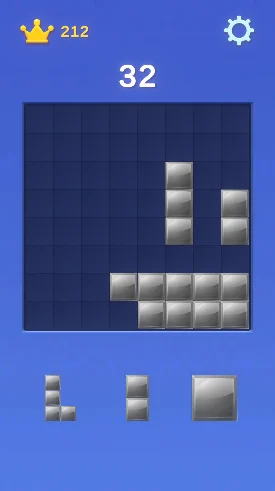

# Block Blaster

> <b>Unity로 제작한 Block Blast 스타일의 2D 블록 퍼즐 게임 모작 프로젝트</b>

---

## 프로젝트 소개

<b>Block Blaster</b>는 모바일 퍼즐 게임 <b>Block Blast</b>의 핵심 플레이 방식을 Unity로 재구현한 2D 캐주얼 퍼즐 게임입니다.

플레이어는 제한된 <b>8x8 보드</b> 위에 다양한 형태의 블록을 드래그하여 배치하고, 가로 또는 세로 줄을 완성하면 해당 줄이 제거되며 점수를 획득합니다.

단순한 조작 방식 안에서

<b>공간 판단, 배치 순서, 다음 블록을 고려한 전략성</b>이 중요한 게임입니다.

이 프로젝트에서는 단순한 블록 배치 기능뿐만 아니라,

<b>보드 판정, 드래그 조작, 라인 클리어, 점수 계산, 콤보, 최고 점수 저장, 사운드, 진동, 씬 전환, 게임오버 처리</b>까지 하나의 완성된 게임 흐름으로 구현했습니다.

---

## 프로젝트 정보

| 항목 | 내용 |
| --- | --- |
| 프로젝트명 | Block Blaster |
| 장르 | 2D 캐주얼 퍼즐 게임 |
| 플랫폼 | PC / Unity 기반 |
| 개발 엔진 | Unity |
| 개발 언어 | C# |
| 참고 게임 | Block Blast |
| 핵심 키워드 | 블록 배치, 퍼즐, 라인 클리어, 콤보, 최고 점수 |

---

## 사용 기술

- Unity
- C#
- Unity UI
- ScriptableObject
- PlayerPrefs
- 2D URP
- Event 기반 UI 갱신 구조
- 오브젝트 풀링
- 씬 전환 시스템
- 사운드 / 진동 피드백 시스템

---

## 핵심 게임 규칙

---

## 1. 8x8 보드

게임은 8x8 크기의 보드에서 진행됩니다.

각 칸은 비어있는 상태 또는 블록이 채워진 상태를 가지며, 블록을 배치하면 해당 칸이 채워집니다.

---

## 2. 블록 배치

플레이어는 화면 하단에 제공되는 블록을 드래그하여 보드 위에 배치합니다.

블록을 배치하기 위해서는 다음 조건을 만족해야 합니다.

- 블록의 모든 칸이 보드 안에 있어야 함
- 블록이 이미 채워진 칸과 겹치면 안 됨
- 블록을 구성하는 모든 칸이 비어 있어야 함

하나라도 조건을 만족하지 못하면 배치가 실패합니다.

---

## 3. 라인 클리어

블록을 배치한 후, 가로줄 또는 세로줄이 전부 채워졌는지 검사합니다.

한 줄이 완성되면 해당 줄의 블록이 제거되고 점수를 획득합니다.

가로줄과 세로줄이 동시에 완성될 수도 있기 때문에, 중복 제거가 발생하지 않도록 제거 대상 칸을 모아 한 번에 처리했습니다.

---

## 4. 점수와 콤보

점수는 블록을 배치할 때마다 증가하며, 라인을 제거하면 추가 점수를 얻습니다.

연속으로 라인을 제거하면 콤보가 이어져 더 높은 점수를 획득할 수 있습니다.

반대로 라인을 제거하지 못한 턴이 발생하면 콤보는 초기화됩니다.

---

## 5. 게임오버

게임오버는 보드가 완전히 가득 찼을 때만 발생하지 않습니다.

현재 가지고 있는 블록 중 하나라도 보드에 배치할 수 있으면 게임은 계속 진행됩니다.

하지만 보유한 모든 블록을 어디에도 놓을 수 없다면 게임오버가 발생합니다.

---

# 게임 플레이 흐름

```txt
게임 시작
↓
블록 3개 생성
↓
플레이어가 블록 드래그
↓
마우스 위치를 보드 좌표로 변환
↓
배치 가능 여부 검사
↓
배치 성공 시 보드 데이터 갱신
↓
가로 / 세로 라인 완성 여부 검사
↓
완성된 라인 제거
↓
점수 및 콤보 갱신
↓
새 블록 생성
↓
배치 가능한 블록이 없으면 게임오버
```

---

# 주요 구현 내용

---

## 보드 시스템

보드는 게임의 핵심 데이터 구조입니다.

각 칸의 상태를 데이터로 관리하고, 블록 배치와 라인 제거는 모두 이 보드 데이터를 기준으로 처리됩니다.

구현한 주요 기능은 다음과 같습니다.

- 8x8 보드 생성
- 셀 좌표 기반 접근
- 보드 범위 검사
- 셀 상태 저장
- 보드 전체 초기화
- 블록 배치 후 상태 갱신

보드 데이터를 UI와 분리해 관리했기 때문에, 실제 게임 판정과 화면 표시가 서로 꼬이지 않도록 구성할 수 있었습니다.

---

## 블록 배치 판정

블록은 하나의 칸이 아니라 여러 칸을 차지하는 조각입니다.

따라서 블록을 배치할 때는 블록을 구성하는 모든 좌표를 검사해야 합니다.

예를 들어 4칸짜리 블록이라면 4개의 칸이 모두 보드 안에 있고, 모두 비어 있어야만 배치가 가능합니다.

이 로직을 통해 다음 문제를 방지했습니다.

- 보드 밖으로 나가는 블록 배치
- 이미 채워진 칸과의 충돌
- 일부 칸만 유효한 잘못된 배치
- 좌표 계산 오류로 인한 비정상 배치

---

## 드래그 앤 드롭 조작

플레이어는 블록을 직접 드래그하여 보드 위에 올립니다.

드래그 중에는 현재 마우스 위치가 보드의 어느 칸에 해당하는지 계산하고, 해당 위치에 블록을 놓을 수 있는지 실시간으로 검사합니다.

배치 가능 여부에 따라 블록의 색상을 다르게 표시하여 플레이어가 현재 위치가 유효한지 쉽게 알 수 있도록 했습니다.

- 배치 가능 위치: 유효 색상 표시
- 배치 불가능 위치: 실패 색상 표시
- 보드 밖 위치: 기본 상태로 복귀
- 드래그 종료 시 배치 성공 또는 원위치 복귀

---

## 화면 좌표와 보드 좌표 변환

이 프로젝트에서 중요한 부분 중 하나는 마우스 위치를 정확한 보드 좌표로 변환하는 것이었습니다.

UI 기반 게임이기 때문에 단순히 마우스 위치만 사용하면 실제 보드 칸과 어긋날 수 있습니다.

이를 해결하기 위해 화면 좌표를 보드 내부 좌표로 변환하고, 다시 보드의 셀 좌표로 계산하는 구조를 만들었습니다.

또한 특정 보드 좌표를 UI상의 칸 중심 위치로 변환하여 블록이 칸 사이에 어긋나지 않고 정확히 스냅되도록 처리했습니다.

---

## 라인 클리어 시스템

블록을 배치한 후에는 모든 행과 열을 검사합니다.

가로줄이나 세로줄이 전부 채워져 있다면 해당 줄을 제거합니다.

이때 가로줄과 세로줄이 동시에 제거될 수 있기 때문에, 교차 지점의 칸이 중복 처리되지 않도록 제거 대상 칸을 하나의 집합으로 모아서 처리했습니다.

이를 통해 Block Blast류 게임의 핵심 재미인

<b>블록을 채우고, 한 번에 제거하는 플레이 감각</b>을 구현했습니다.

---

## 점수 및 콤보 시스템

점수는 크게 두 가지 요소로 구성됩니다.

- 블록 배치 점수
- 라인 제거 점수

여기에 연속으로 라인을 제거하면 콤보가 적용되어 더 높은 점수를 얻을 수 있습니다.

점수 시스템에는 다음 요소를 포함했습니다.

- 배치한 블록 수에 따른 기본 점수
- 제거한 라인 수에 따른 추가 점수
- 연속 라인 제거 시 콤보 보너스
- 라인 제거 실패 시 콤보 초기화
- 최고 점수 갱신 및 저장

---

## 게임오버 시스템

게임오버 판정은 현재 손패에 있는 블록들을 기준으로 처리했습니다.

보드 전체를 검사하여 현재 블록 중 하나라도 놓을 수 있는 위치가 있는지 확인합니다.

하나라도 배치 가능한 블록이 있다면 게임은 계속 진행되고, 모든 블록이 배치 불가능한 상태라면 게임오버가 발생합니다.

이 방식은 단순히 보드가 가득 찼는지를 보는 것보다 실제 퍼즐 게임 규칙에 더 정확합니다.

---

## UI 갱신 구조

보드의 실제 데이터와 화면에 표시되는 타일은 분리해서 관리했습니다.

게임 데이터가 변경되면 이벤트를 통해 UI가 반응하는 방식으로 구성했습니다.

예를 들어 블록 배치가 성공하면 배치된 좌표에 타일 UI가 생성되고, 라인이 제거되면 해당 좌표의 타일 UI가 사라집니다.

이 구조를 통해 보드 데이터와 시각적 표현을 독립적으로 관리할 수 있었습니다.

---

## 오브젝트 풀링

타일 UI는 게임 중 자주 생성되고 제거됩니다.

매번 새로 생성하고 삭제하면 성능에 부담이 될 수 있기 때문에, 사용이 끝난 타일을 비활성화한 뒤 다시 재사용하는 풀링 구조를 적용했습니다.

이를 통해 반복적인 라인 제거 상황에서도 안정적인 UI 처리가 가능하도록 했습니다.

---

## 라인 제거 VFX

라인이 제거될 때 단순히 블록만 사라지는 것이 아니라, 행 또는 열 방향으로 제거 연출이 출력되도록 구성했습니다.

특히 마지막에 배치한 블록의 색상을 기준으로 VFX 색상을 맞춰, 플레이어가 방금 배치한 블록과 라인 제거 결과를 자연스럽게 연결해서 느낄 수 있도록 했습니다.

---

## 사운드 및 진동 피드백

게임의 조작감을 높이기 위해 상황별 사운드와 진동 피드백을 추가했습니다.

적용한 피드백은 다음과 같습니다.

- 블록 배치 성공 사운드
- 블록 배치 실패 사운드
- 라인 제거 성공 사운드
- 버튼 클릭 사운드
- 게임 종료 사운드
- 라인 제거 시 진동
- 배치 실패 시 진동

단순한 퍼즐 게임이지만, 조작 결과가 명확하게 느껴지도록 피드백 중심으로 구성했습니다.

---

## 저장 시스템

최고 점수와 설정값은 PlayerPrefs를 이용해 저장했습니다.

저장되는 데이터는 다음과 같습니다.

- 최고 점수
- BGM 설정
- SFX 설정
- 진동 설정

게임을 다시 실행해도 최고 기록과 설정이 유지되도록 구성했습니다.

---

## 씬 전환 시스템

로비, 게임, 크레딧 씬 간 이동을 관리하는 씬 전환 시스템을 구현했습니다.

씬 전환 시에는 페이드 효과를 적용하여 화면이 자연스럽게 넘어가도록 만들었습니다.

또한 중복 로딩을 방지하기 위해 현재 로딩 중인지 확인하는 구조를 포함했습니다.

---

# 블록 데이터 관리

블록 모양은 코드에 직접 고정하지 않고 데이터 형태로 관리했습니다.

각 블록 데이터는 다음 정보를 가집니다.

- 블록 ID
- 블록을 구성하는 셀 좌표 목록
- 드래그 기준점
- 타일 스프라이트
- 타일 색상
- 타일 머티리얼

이 구조 덕분에 새로운 블록을 추가하거나 기존 블록 형태를 수정할 때 코드 수정 없이 데이터만 변경할 수 있습니다.

---

# 블록 제작 도구

블록 데이터를 직접 만들기 편하도록 별도의 블록 제작 도구도 구성했습니다.

블록 메이커를 통해 블록 형태를 시각적으로 만들고, 회전 또는 반전한 뒤 데이터로 저장할 수 있습니다.

이를 통해 블록 조각을 하나씩 코드로 작성하지 않고도 다양한 형태의 블록을 빠르게 제작할 수 있도록 했습니다.

---

# 인게임 이미지



---

# 트러블슈팅

---

## 문제 1. 마우스 위치와 실제 보드 좌표가 어긋나는 문제

### 원인

UI 기반 보드에서 마우스 화면 좌표를 그대로 사용하면, 실제 보드의 로컬 좌표와 일치하지 않는 문제가 발생했습니다.

이로 인해 블록이 플레이어가 의도한 칸이 아닌 다른 칸에 배치될 가능성이 있었습니다.

### 해결

화면 좌표를 보드 RectTransform 기준의 로컬 좌표로 변환한 뒤, 셀 크기를 기준으로 실제 보드 좌표를 계산하도록 구조를 분리했습니다.

또한 계산된 좌표를 다시 칸 중심 위치로 변환하여 블록이 정확히 셀 중앙에 스냅되도록 처리했습니다.

---

## 문제 2. 가로줄과 세로줄이 동시에 제거될 때 중복 처리되는 문제

### 원인

가로줄과 세로줄이 동시에 완성될 경우, 두 줄이 교차하는 칸이 중복으로 제거 대상에 포함될 수 있었습니다.

### 해결

제거할 칸을 리스트로 바로 처리하지 않고, 중복을 허용하지 않는 집합 구조로 먼저 모은 뒤 한 번만 제거하도록 수정했습니다.

이를 통해 교차 지점의 칸도 안정적으로 처리할 수 있었습니다.

---

## 문제 3. 게임오버 UI가 보드 타일에 가려지는 문제

### 원인

게임오버가 발생했을 때, 기존에 배치되어 있던 타일 UI가 게임오버 화면보다 위에 남아 UI를 가리는 문제가 발생할 수 있었습니다.

### 해결

게임오버 시점에 배치된 타일 레이어를 정리하고, 게임오버 UI가 정상적으로 보이도록 처리했습니다.

---

## 문제 4. 게임오버 조건이 단순 보드 상태만으로는 정확하지 않은 문제

### 원인

보드에 빈칸이 남아 있어도 현재 들고 있는 블록의 형태에 따라 더 이상 배치할 수 없는 상황이 발생할 수 있습니다.

단순히 빈칸 개수만 확인하면 정확한 게임오버 판정을 할 수 없었습니다.

### 해결

현재 손패에 있는 모든 블록을 기준으로 보드 전체를 탐색하고, 하나라도 배치 가능한 위치가 있는지 검사하도록 구현했습니다.

이를 통해 실제 Block Blast류 게임에 가까운 게임오버 판정을 만들 수 있었습니다.

---

# 구현을 통해 배운 점

이번 프로젝트를 통해 보드 기반 퍼즐 게임에서 중요한 것은 단순히 블록을 배치하는 기능이 아니라는 것을 알게 되었습니다.

블록의 좌표 데이터, 보드 상태, UI 위치, 드래그 입력, 배치 판정, 라인 제거, 점수 계산이 모두 정확히 맞물려야 자연스러운 플레이가 가능했습니다.

특히 UI 좌표와 게임 데이터 좌표를 분리해서 관리하는 경험을 통해, 화면에 보이는 것과 실제 데이터가 어긋나지 않게 설계하는 것이 얼마나 중요한지 배울 수 있었습니다.

또한 게임오버 조건처럼 겉으로는 단순해 보이지만 실제로는 모든 블록과 모든 보드 위치를 검사해야 하는 로직을 구현하면서, 퍼즐 게임의 규칙을 코드로 정확히 옮기는 연습을 할 수 있었습니다.

---
