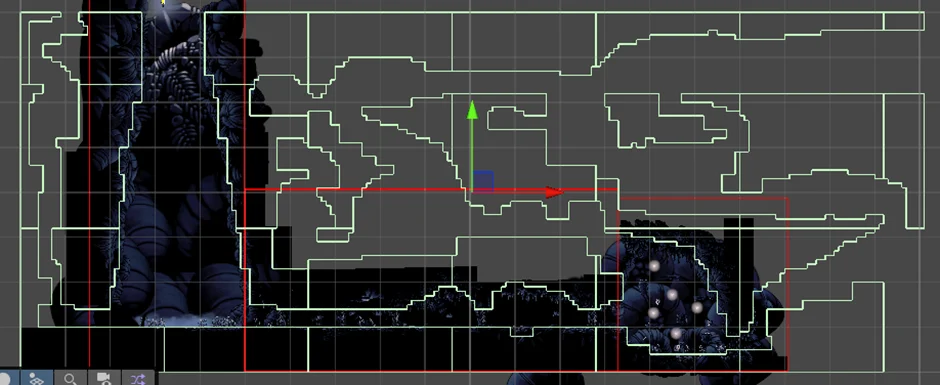
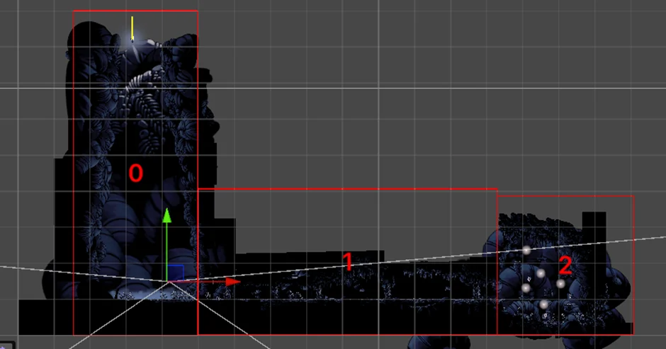

# 2D Platformer Project

## 프로젝트 개요

<b>2D Platformer Project</b>는 액션 어드벤처 게임 <b>Hollow Knight</b>를 참고하여 제작한 2D 플랫포머 모작 프로젝트입니다.

제한된 제작 기간 안에서 원작의 전체 구조를 구현하기보다는, 튜토리얼 지역의 일부 구간을 중심으로 플레이어 조작, 전투, 몬스터 패턴, 맵 구성, 카메라 전환 등 핵심적인 2D 플랫포머 기능을 구현하는 것을 목표로 진행했습니다.

---

## 프로젝트 정보

| 항목 | 내용 |
| --- | --- |
| 프로젝트 유형 | 2D 플랫포머 모작 프로젝트 |
| 참고 게임 | Hollow Knight |
| 개발 엔진 | Unity |
| 구현 범위 | 튜토리얼 지역 일부 |
| 핵심 구현 | 플레이어 조작, 공격, 이단 점프, 몬스터 패턴, 룸 기반 카메라, 타일맵 기반 맵 제작 |

---

## 제작 목표

이 프로젝트의 목표는 Hollow Knight의 기본적인 플레이 감각과 2D 플랫포머 구조를 직접 구현해보는 것이었습니다.

특히 단순히 캐릭터가 이동하는 수준이 아니라, 실제 게임처럼 느껴질 수 있도록 다음 요소들을 중점적으로 제작했습니다.

- 플레이어의 이동, 점프, 이단 점프
- 공격 방향과 타이밍에 따른 애니메이션 분리
- 피격, 착지, 점프, 공격 등 상태별 사운드 구현
- 다양한 이펙트를 활용한 타격감 표현
- 여러 종류의 몬스터 패턴 구현
- 룸 단위 구역 분할과 카메라 이동
- 타일맵과 스프라이트 오브젝트를 활용한 배경 구성

---

## 주요 구현 기능

### 1. 배경 및 씬 구성

배경은 여러 개의 레이어로 나누어 구성했습니다.

2D 환경이지만 단순히 평면적으로 보이지 않도록, 오브젝트를 여러 깊이감으로 배치하여 입체적인 느낌을 주고자 했습니다.

제작 초기에는 타일맵을 이용해 전체 맵의 뼈대를 먼저 제작했습니다. 이후 타일맵 위에 다양한 스프라이트 오브젝트를 덮어 씌우는 방식으로 디테일을 추가했습니다.

이 방식을 통해 전체적인 맵 구조를 빠르게 잡을 수 있었고, 타일맵을 기준으로 오브젝트를 배치하면서 작업 속도를 높일 수 있었습니다.

---

### 2. 플레이어 시스템

플레이어는 2D 플랫포머의 기본 조작감을 중심으로 구현했습니다.

### 이단 점프

플레이어가 공중에서 한 번 더 점프할 수 있도록 이단 점프를 구현했습니다.

이단 점프 시에는 일반 점프와 다른 모션을 사용하여 동작이 구분되도록 만들었고, 다시 땅에 닿기 전까지는 추가 점프가 불가능하도록 처리했습니다.

### 공격 모션 분리

공격은 단순히 하나의 애니메이션만 반복되는 방식이 아니라, 공격 타이밍과 방향에 따라 다른 모션이 나오도록 구성했습니다.

예를 들어 올려베기 이후에는 내려베기 모션으로 자연스럽게 이어지도록 만들었고, 상단 공격과 하단 공격에도 각각 다른 애니메이션을 적용했습니다.

이를 통해 전투 동작이 더 자연스럽고 역동적으로 보이도록 했습니다.

### 이펙트와 사운드

플레이어가 벽을 파괴하거나 적을 공격할 때 다양한 이펙트를 발생시켜 타격감을 높였습니다.

또한 피격, 착지, 점프, 공격, 낙하 등 플레이어의 상태 변화에 따라 서로 다른 사운드가 재생되도록 구현했습니다.

---

### 3. 몬스터 시스템

몬스터는 총 3가지 유형을 구현했습니다.

### Runner

Runner 적은 전방에 플레이어가 감지되면 공격 행동을 수행하도록 구현했습니다.

일반적인 이동형 적보다는 플레이어 인식 기반의 전투 패턴을 가진 적으로 제작했습니다.

### Fly

Fly 적은 벽면과 충돌하거나 일정 시간이 지나면 방향을 전환합니다.

또한 플레이어와 충돌하면 데미지를 주는 방식으로 구현했습니다.

### Crawler

Crawler 적은 정해진 범위 안에서 좌우로 이동하며, 플레이어와 충돌했을 때 데미지를 주도록 구현했습니다.

각 몬스터는 단순한 배치물이 아니라, 서로 다른 움직임과 충돌 방식을 가지도록 제작했습니다.

---

### 4. 카메라 및 구역 분할

맵은 하나의 큰 공간으로만 구성하지 않고, 여러 개의 룸으로 나누어 제작했습니다.

플레이어가 특정 구역으로 이동하면 해당 룸에 맞춰 카메라가 전환되도록 구현했습니다.

이를 통해 맵이 자연스럽게 구역별로 나뉘어 있는 느낌을 주고자 했습니다.

---

## 구현 과정에서 신경 쓴 부분

### 1. 2D 배경의 입체감 표현

Hollow Knight의 배경은 작은 오브젝트들을 여러 겹으로 배치해 깊이감을 만드는 방식이었습니다.

처음에는 단순히 배경 이미지만 배치하면 된다고 생각했지만, 실제로는 여러 개의 작은 스프라이트를 조합하고 위치를 세밀하게 조절해야 자연스러운 배경이 만들어졌습니다.

이 과정에서 배경 레이어를 나누는 방식과 오브젝트 배치의 중요성을 알게 되었습니다.

---

### 2. 플레이어 액션의 자연스러움

플레이어의 공격이 어색하지 않게 보이도록 공격 모션을 여러 개로 분리했습니다.

상단 공격, 하단 공격, 연속 공격의 흐름이 자연스럽게 이어지도록 애니메이션을 다르게 구성했습니다.

또한 공격 이펙트와 사운드를 함께 적용하여 조작했을 때의 반응성을 높이고자 했습니다.

---

### 3. 룸 단위 카메라 구성

카메라가 항상 플레이어만 따라가는 방식이 아니라, 룸 단위로 구역을 나누고 해당 구역에 맞춰 카메라가 이동하도록 구성했습니다.

이를 통해 플레이어가 새로운 구역에 들어갔을 때 공간이 전환되는 느낌을 줄 수 있었습니다.

---

## 어려웠던 점

### 1. 배경 레이어와 원근감 구성

가장 어려웠던 부분은 배경 제작이었습니다.

원작처럼 자연스러운 배경을 만들기 위해서는 작은 오브젝트들을 여러 개 조합하고, 위치와 깊이감을 세밀하게 조정해야 했습니다.

특히 어떤 오브젝트를 어느 정도의 깊이감으로 배치해야 자연스럽게 보이는지 판단하는 데 많은 시간이 걸렸습니다.

작업량이 예상보다 많았기 때문에 처음 계획했던 만큼 풍성한 배경을 완성하지는 못했습니다.

---

### 2. 비행 몬스터 구현의 한계

처음에는 플레이어를 추적하는 비행 몬스터를 구현하고자 했습니다.

하지만 공중 플랫폼과 발판을 제대로 인식하지 못하고, 몬스터가 발판에 막히는 문제가 발생했습니다.

조사해본 결과, 이런 문제를 해결하려면 Poly Nav와 같은 방식으로 맵 구조를 몬스터에게 인식시켜야 한다는 것을 알게 되었습니다.

다만 제작 기간이 제한되어 있었기 때문에 해당 기능은 최종 구현 범위에서 제외했습니다.

---

### 3. 오브젝트 배치와 리소스 탐색

Hollow Knight 스타일의 배경은 적은 수의 스프라이트를 단순히 배치하는 방식이 아니라, 작은 조각들을 조합해 다양한 공간을 만드는 방식이었습니다.

이 때문에 필요한 리소스를 찾고, 적절한 위치에 배치하는 과정이 예상보다 오래 걸렸습니다.

결과적으로 이 프로젝트에서 가장 많은 시간이 들어간 작업은 오브젝트 배치와 배경 구성이라고 느꼈습니다.

---

## 시간이 더 있었다면 추가하고 싶은 기능

### 1. 더 다양한 적 패턴

현재는 기본적인 몬스터 패턴만 구현했습니다.

시간이 더 있었다면 2가지 이상의 공격 패턴을 가진 적이나, 보스 몬스터를 구현해보고 싶었습니다.

보스 몬스터를 제작하면 단순 이동 패턴보다 더 복잡한 상태 전환, 공격 타이밍, 피격 처리 등을 경험할 수 있을 것이라 생각했습니다.

---

### 2. 구역 확장

현재 구현된 구역은 튜토리얼 지역의 일부입니다.

타일맵 자체는 더 넓게 제작했지만, 오브젝트 배치와 디테일 작업에 시간이 오래 걸려 일부 구간만 완성했습니다.

시간이 더 있었다면 튜토리얼 지역 전체를 플레이 가능한 형태로 확장하고 싶었습니다.

---

### 3. 화폐 시스템

적을 처치하거나 보물상자를 열었을 때 화폐가 드롭되는 시스템을 추가하고 싶었습니다.

이를 통해 전투와 탐험에 보상을 연결하고, 이후 상점이나 강화 시스템으로 확장할 수 있는 구조를 만들 수 있을 것이라 생각했습니다.

---

## 개선하고 싶은 점

제작 초기에 배경 레이어 구조를 충분히 구체적으로 설계하지 못한 점이 아쉬웠습니다.

원작의 배경 구조를 자세히 분석하지 않고 작업을 시작했기 때문에, 제작 도중 레이어가 부족하거나 일부 오브젝트 구성이 어색해지는 문제가 발생했습니다.

이후 부족한 부분을 중간에 보완하려고 했지만, 전체 구조를 다시 잡기에는 시간이 부족했습니다.

다음 프로젝트에서는 제작 초기에 레이어 구조, 오브젝트 배치 방식, 카메라 구역 구조를 더 명확하게 설계한 뒤 작업을 진행하고 싶습니다.

---

## 프로젝트를 통해 배운 점

이번 프로젝트를 통해 2D 플랫포머 게임에서 중요한 요소가 단순한 이동과 점프만이 아니라는 것을 알게 되었습니다.

플레이어의 조작감, 공격 모션, 이펙트, 사운드, 카메라 이동, 배경 레이어, 몬스터 패턴이 모두 합쳐져야 실제 게임처럼 느껴지는 플레이 경험이 만들어졌습니다.

특히 Hollow Knight처럼 완성도 높은 2D 게임은 작은 오브젝트 배치와 배경 레이어 하나까지도 세밀하게 설계되어 있다는 점을 직접 느낄 수 있었습니다.

이번 프로젝트는 제한된 시간 안에서 모든 기능을 완성하지는 못했지만, 2D 액션 플랫포머의 기본 구조와 제작 난이도를 경험할 수 있었던 의미 있는 작업이었습니다.

---
