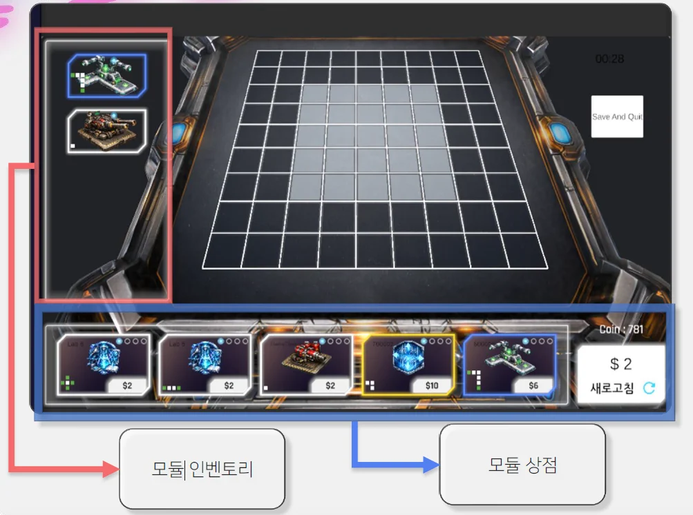

# Project Invader

> <b>Unity 3D 기반 3D 쿼터뷰 SF 오토 배틀러 게임의 보드 및 모듈 시스템 구현</b>

---

## 프로젝트 소개

<b>Project Invader</b>는 Unity 3D를 활용해 제작한 <b>3D 쿼터뷰 SF 오토 배틀러 게임</b>입니다.

플레이어는 전투 전에 보드 위에 다양한 모듈을 배치하고,

배치된 모듈 조합에 따라 전투에서 생산되는 유닛, 스탯, 전투 효율이 달라집니다.

제가 담당한 부분은 이 게임의 핵심 준비 단계인 <b>보드 시스템과 모듈 배치 시스템</b>입니다.

단순히 오브젝트를 보드 위에 놓는 기능이 아니라,

모듈 선택, 회전, 미리보기, 배치 가능 여부 판정, 실제 배치, 회수, 전투 데이터 변환까지 이어지는 구조를 설계하고 구현했습니다.

---

## 프로젝트 정보

| 항목 | 내용 |
| --- | --- |
| 프로젝트명 | Project Invader |
| 장르 | 3D 쿼터뷰 SF 오토 배틀러 |
| 개발 엔진 | Unity |
| 개발 언어 | C# |
| 담당 파트 | 보드 시스템, 모듈 시스템 |
| 핵심 키워드 | 모듈 배치, 그리드 보드, 인벤토리 테트리스, 데이터 기반 배치, 전투 연동 |

---

## 담당 구현 요약

제가 구현한 시스템은 크게 두 가지입니다.

- 보드 시스템
- 모듈 시스템

보드 시스템은 모듈이 배치되는 공간을 관리하는 역할을 담당합니다.

모듈 시스템은 플레이어가 모듈을 선택하고, 회전하고, 보드 위에 배치하며, 배치된 결과를 전투 시스템으로 넘기는 역할을 담당합니다.

---

# 보드 시스템



## 보드 시스템 개요

보드 시스템은 모듈 배치의 기준이 되는 그리드 기반 시스템입니다.

플레이어가 보는 3D 보드의 위치와 실제 코드에서 판정하는 좌표가 다르면

모듈이 의도한 위치에 배치되지 않거나, 배치 가능 여부가 잘못 판단될 수 있습니다.

이를 방지하기 위해 보드의 시각적 위치와 논리적 좌표를 일치시키는 구조를 만들었습니다.

---

## 주요 기능

- 보드 좌표 관리
- 마우스 위치를 그리드 좌표로 변환
- 보드 셀 크기와 기준점 관리
- 모듈 배치 가능 여부 검사
- 이미 배치된 모듈 점유 상태 관리
- 배치된 모듈 제거 처리
- 보드 확장 처리
- 강화 칸 및 버프 영향 칸 관리
- 현재 배치 상태를 외부 시스템에 전달

---

## GridRoot

<b>GridRoot</b>는 플레이어 입력 위치를 실제 보드 좌표로 변환하는 역할을 담당합니다.

마우스가 가리키는 월드 좌표를 받아서

CellSize와 Origin 기준으로 그리드 좌표를 계산하고,

해당 좌표에 맞는 스냅 위치를 반환합니다.

이 구조를 통해 화면에서 보이는 위치와 실제 배치 판정 좌표가 어긋나지 않도록 했습니다.

---

## GridManager

<b>GridManager</b>는 보드의 실제 상태를 관리하는 핵심 클래스입니다.

각 칸이 비어 있는지, 이미 모듈이 놓여 있는지, 배치 가능한 위치인지 판단합니다.

모듈 배치가 요청되면 GridManager가 최종적으로 배치 가능 여부를 검사하고,

가능한 경우에만 실제 보드 상태를 갱신합니다.

GridManager에서 관리한 주요 기능은 다음과 같습니다.

- 빈 칸 / 점유 칸 판정
- 모듈 배치 가능 여부 확인
- 실제 모듈 배치 처리
- 모듈 제거 처리
- 동일 위치 업그레이드 판정
- 보드 확장 처리
- 현재 배치된 모듈 정보 반환

---

# 모듈 시스템

## 모듈 시스템 개요

모듈 시스템은 Project Invader의 전략성을 만드는 핵심 시스템입니다.

플레이어는 상점에서 모듈을 구매하고,

인벤토리에 보관한 뒤, 보드 위에 배치합니다.

배치된 모듈은 전투 시스템으로 전달되어

아군 유닛 생산, 스탯 변화, 전투 효율 등에 영향을 줍니다.

즉, 모듈 시스템은 전투 전에 플레이어가 전략을 설계하는 준비 단계입니다.

---

## 모듈 배치 흐름

```txt
모듈 선택
↓
마우스 위치 확인
↓
보드 좌표 변환
↓
모듈 회전 및 형태 계산
↓
배치 가능 여부 검사
↓
미리보기 갱신
↓
실제 배치
↓
보드 상태 갱신
↓
전투 데이터로 변환
```

---

## PlaceManager

<b>PlaceManager</b>는 모듈 배치 흐름을 제어하는 중앙 제어 클래스입니다.

모듈 배치 시스템은 실시간 상호작용이 많기 때문에,

입력 처리와 배치 로직이 여러 스크립트에 흩어지면 관리가 어려워질 수 있습니다.

그래서 PlaceManager가 플레이어 입력과 그리드 배치 로직 사이를 연결하는 역할을 담당하도록 설계했습니다.

주요 기능은 다음과 같습니다.

- 선택된 모듈 드래그 처리
- 입력에 따른 모듈 회전
- 배치 가능 여부 실시간 확인
- 배치 가능 / 불가능 상태 미리보기 반영
- 실제 배치 진행
- 배치 취소 처리
- 배치된 모듈 제거 처리
- 전투 중 배치 입력 차단

---

## PlaceCalc

<b>PlaceCalc</b>는 모듈의 형태를 계산하는 클래스입니다.

모듈은 모두 같은 크기가 아니라,

여러 칸을 차지하거나 회전될 수 있는 형태를 가집니다.

따라서 모듈의 문자열 데이터를 기반으로

현재 회전 상태에서 어떤 칸들을 차지하는지 계산하는 구조가 필요했습니다.

PlaceCalc를 통해 다양한 형태의 모듈을 하드코딩하지 않고,

데이터 기반으로 공통 처리할 수 있도록 만들었습니다.

---

## ModuleView와 GridPlaneVisual

<b>ModuleView</b>는 모듈의 시각적 표시를 담당합니다.

모듈을 배치하기 전에는 미리보기를 보여주고,

배치가 완료되면 실제 모듈 오브젝트를 보드 위에 표시합니다.

<b>GridPlaneVisual</b>은 보드 칸의 시각적 상태를 담당합니다.

배치 가능한 위치인지, 불가능한 위치인지,

또는 버프나 강화 영향을 받는 칸인지 시각적으로 구분할 수 있도록 구성했습니다.

---

## SpawnerDataBridge

모듈 배치 시스템은 전투 시스템과 직접 연결되어야 합니다.

하지만 보드 위에 배치된 모듈 데이터는

전투 시스템에서 바로 사용할 수 있는 형태가 아니기 때문에 변환 과정이 필요했습니다.

<b>SpawnerDataBridge</b>는 배치된 모듈 정보를 전투 시스템이 사용할 수 있는 데이터로 변환하는 역할을 합니다.

이를 통해 모듈 시스템과 전투 시스템의 직접 의존도를 줄이고,

배치 결과가 자연스럽게 유닛 생산 데이터로 이어지도록 만들었습니다.

---

# 모듈 인벤토리와 상점 연동

모듈 시스템은 인벤토리와 상점 시스템과도 연결됩니다.

플레이어는 상점에서 모듈을 구매하고,

구매한 모듈은 인벤토리에 저장됩니다.

이후 인벤토리에서 모듈을 보드로 드래그하면 배치가 진행되고,

배치된 모듈을 회수하면 다시 인벤토리로 돌아오도록 구성했습니다.

주요 흐름은 다음과 같습니다.

- 상점에서 모듈 구매
- 구매한 모듈을 인벤토리에 저장
- 인벤토리에서 보드로 드래그하여 배치
- 배치된 모듈 우클릭 시 회수
- 회수된 모듈을 다시 인벤토리에 저장

이 구조를 통해 상점, 인벤토리, 보드 배치가 하나의 흐름으로 연결되도록 했습니다.

---

# 시스템 구조

```txt
PlaceManager
↓
GridRoot
↓
PlaceCalc
↓
GridManager
↓
ModuleView / GridPlaneVisual
↓
SpawnerDataBridge
↓
SpawnerDataBuilder
↓
전투 시스템
```

---

# 구현하면서 신경 쓴 부분

## 1. 역할 분리

처음에는 모듈 배치에 필요한 기능이 많아 하나의 스크립트에 모든 기능이 몰릴 위험이 있었습니다.

이를 방지하기 위해 입력은 PlaceManager,

좌표 변환은 GridRoot,

배치 판정은 GridManager,

형태 계산은 PlaceCalc처럼 역할을 나누었습니다.

이 구조 덕분에 기능을 수정하거나 확장할 때 어느 부분을 고쳐야 하는지 명확해졌습니다.

---

## 2. 데이터 기반 모듈 처리

모듈마다 모양과 크기가 다르기 때문에

각 모듈을 코드로 따로 처리하면 유지보수가 어려워질 수 있었습니다.

그래서 모듈의 형태를 데이터로 관리하고,

PlaceCalc에서 해당 데이터를 기반으로 배치 영역을 계산하도록 만들었습니다.

이를 통해 새로운 모듈이 추가되어도 기존 코드를 크게 수정하지 않고 대응할 수 있도록 했습니다.

---

## 3. 시각 좌표와 논리 좌표 일치

보드 배치 시스템에서 가장 중요한 부분은

플레이어가 보는 위치와 실제 판정 좌표가 일치하는 것입니다.

GridRoot를 통해 월드 좌표를 그리드 좌표로 변환하고,

GridManager가 해당 좌표를 기준으로 최종 배치 여부를 판단하도록 구성했습니다.

---

## 4. 전투 시스템과의 연결

모듈 시스템은 단독으로 끝나는 시스템이 아니라,

전투 시스템으로 데이터를 넘겨야 의미가 있습니다.

그래서 SpawnerDataBridge를 통해 배치된 모듈 정보를 전투용 데이터로 변환하도록 만들었습니다.

이 구조를 통해 모듈 배치 결과가 실제 전투 유닛 생산에 반영되도록 연결했습니다.

---

# 트러블슈팅

## 문제 1. 모듈의 시각적 위치와 실제 배치 좌표가 어긋나는 문제

### 원인

마우스 위치를 그대로 사용하면 3D 보드 위의 실제 셀 좌표와 일치하지 않는 문제가 발생할 수 있었습니다.

### 해결

GridRoot에서 월드 좌표를 CellSize와 Origin 기준의 그리드 좌표로 변환하도록 구현했습니다.

이를 통해 모듈이 보이는 위치와 실제 판정 위치가 일치하도록 했습니다.

---

## 문제 2. 다양한 형태의 모듈을 처리하기 어려운 문제

### 원인

모듈마다 차지하는 칸의 형태가 다르고, 회전까지 고려해야 했기 때문에

모듈별로 개별 로직을 작성하면 코드가 복잡해질 수 있었습니다.

### 해결

모듈 형태를 데이터 기반으로 처리하고, PlaceCalc에서 회전된 영역을 계산하도록 구성했습니다.

이를 통해 다양한 모듈 형태를 하나의 공통 로직으로 처리할 수 있었습니다.

---

## 문제 3. 모듈 배치 결과를 전투 시스템으로 넘기는 문제

### 원인

보드에 배치된 모듈 정보와 전투 시스템에서 필요한 스폰 데이터의 형태가 달랐습니다.

### 해결

SpawnerDataBridge를 통해 배치 정보를 전투 시스템용 데이터로 변환했습니다.

이 구조 덕분에 모듈 시스템과 전투 시스템이 직접 강하게 연결되지 않고도 데이터를 전달할 수 있었습니다.

---

# 담당 구현 정리

- 보드 좌표 시스템 구현
- GridRoot 기반 월드 좌표 → 그리드 좌표 변환 구현
- GridManager 기반 보드 상태 관리 구현
- 모듈 배치 가능 여부 판정 구현
- 모듈 선택, 회전, 미리보기 구현
- PlaceManager 기반 배치 흐름 제어
- PlaceCalc 기반 모듈 형태 및 회전 계산
- ModuleView 기반 모듈 시각화
- GridPlaneVisual 기반 보드 미리보기 구현
- 모듈 배치 및 제거 처리
- 모듈 인벤토리와 보드 배치 연동
- 배치된 모듈 정보를 전투 데이터로 변환
- SpawnerDataBridge 연동
- 모듈 3D 모델링 제작

---

# 구현을 통해 배운 점

이번 프로젝트를 통해 단순히 기능을 구현하는 것보다,

여러 시스템과 연결될 수 있는 구조를 설계하는 것이 중요하다는 것을 느꼈습니다.

특히 PlaceManager, GridManager, GridRoot처럼 역할을 명확하게 분리하면서

처음 설계에 시간이 걸리더라도 이후 유지보수와 기능 확장 측면에서 훨씬 효율적이라는 것을 체감했습니다.

또한 모듈의 형태를 데이터 기반으로 처리하고,

회전이나 여러 칸을 차지하는 구조를 공통 로직으로 해결하면서

하나의 시스템으로 다양한 케이스를 처리하는 방법을 경험할 수 있었습니다.

단순히 동작만 하는 기능이 아니라,

새로운 모듈이 추가되더라도 기존 코드를 크게 수정하지 않고 대응할 수 있는 구조를 만드는 것이 인상 깊었습니다.
